DSH机构图

这张图表达的核心架构思想是：

- **一切皆插件**：模型适配器、工具注册表、会话日志、Agent Loop 都是可替换插件。
- **Profile + Bundle + Patch**：启动时按层叠加配置，最终生成一棵 Cordis 插件树。
- **Cordis Context 驱动协作**：插件通过共享 `ctx`、类型化事件和能力 Seam 进行组合。
- **Agent Loop 是执行中枢**：负责轮次、步骤、模型请求、流式响应、工具调用与重试。
- **能力通过 Seam 解耦**：文件系统、Shell、PTY、LSP、沙箱、审批、遥测等都可以替换实现。
- **会话日志是事实源**：模型上下文、恢复、回放和 UI 增量都从 Session Event 派生。

```mermaid
flowchart LR
    %% =========================
    %% Entry Layer
    %% =========================
    subgraph ENTRY["入口层 · Application Entry"]
        CLI["CLI / npm<br/>npx @deepseek-ai/dsh web"]
        DESKTOP["Electron Desktop<br/>Desktop Host"]
        SDK["TypeScript / Python SDK"]
        ACP["ACP Automation"]
    end

    %% =========================
    %% Assembly Layer
    %% =========================
    subgraph ASSEMBLY["启动与组装层 · Profile & Bundle Assembly"]
        LAUNCHER["dsh Launcher"]
        PROFILE["Profile<br/>web · headless · sdk<br/>sdk-minimal · acp"]
        BUNDLE["Bundle Layers<br/>dsh-base · web-app<br/>headless · sdk-app · acp-app"]
        PATCH["Patch Stack<br/>Bundle Patch → Profile Patch<br/>Home Patch → --patch Overlay"]
        TREE["Resolved Plugin Tree<br/>最终运行时配置"]
    end

    %% =========================
    %% Cordis Runtime
    %% =========================
    subgraph CORDIS["Cordis 插件运行时 · Everything is a Plugin"]
        CTX["Shared Context<br/>ctx"]
        PLUGINS["Plugin Composition<br/>注册 · 组合 · 可逆副作用"]
        EVENTS["Typed Event Domains<br/>Session Events · Agent Events<br/>Capability Events"]
    end

    %% =========================
    %% Agent Runtime
    %% =========================
    subgraph AGENT["核心智能体运行时 · Agent Runtime"]
        SESSION["Session & SessionStore<br/>追加式 SessionEvent 日志<br/>JSONL 持久化"]
        LOOP["Agent Loop<br/>turn → step → request<br/>stream → tool → result"]
        PROMPT["System Prompt Assembly<br/>提示词片段 + 工具 Schema"]
        LLM["LLM Adapter Seam<br/>模型调用 · 流式输出 · 取消"]
        TOOLS["Tool Registry & Execution Pipeline<br/>pre-execute → execute → post-execute"]
        AGENTS["Agent Registry<br/>Subagent · Agent Teams"]
    end

    %% =========================
    %% Capability Layer
    %% =========================
    subgraph CAP["可替换能力层 · Capability Seams"]
        FS["Filesystem<br/>Working Directory"]
        PROC["Subprocess / Shell<br/>PTY · LSP"]
        SAFE["Sandbox & Approval<br/>安全策略"]
        CONFIG["Settings & Credentials"]
        OPS["Telemetry · Jobs<br/>Commands · Webhooks"]
    end

    %% =========================
    %% External Systems
    %% =========================
    subgraph OUT["外部系统与产品表面 · External Systems"]
        MODELS["Model Providers<br/>DeepSeek / Other LLMs"]
        EXEC["Local / Remote Execution<br/>本地进程 · 远程沙箱"]
        SURFACE["Web UI / Desktop UI<br/>SDK JSON-RPC / ACP"]
    end

    %% Entry to assembly
    CLI --> LAUNCHER
    DESKTOP --> LAUNCHER
    SDK --> LAUNCHER
    ACP --> LAUNCHER

    LAUNCHER --> PROFILE
    PROFILE --> BUNDLE
    BUNDLE --> TREE
    PATCH -. "覆盖 / 插入配置" .-> TREE

    %% Assembly to runtime
    TREE --> CTX
    CTX --> PLUGINS
    PLUGINS --> EVENTS

    %% Core runtime
    CTX --> SESSION
    CTX --> LOOP
    CTX --> TOOLS
    CTX --> LLM
    CTX --> AGENTS

    SESSION -->|"deriveMessages()"| PROMPT
    LOOP --> PROMPT
    PROMPT --> LLM
    LOOP --> TOOLS
    LOOP <--> AGENTS
    EVENTS --> SESSION

    %% Capability seams
    TOOLS --> FS
    TOOLS --> PROC
    TOOLS --> SAFE
    TOOLS --> OPS
    LLM --> CONFIG
    CTX --> CONFIG
    CTX --> SAFE
    CTX --> OPS

    %% External integrations
    LLM --> MODELS
    FS --> EXEC
    PROC --> EXEC
    SAFE --> EXEC

    SESSION --> SURFACE
    EVENTS -->|"session/event · live stream"| SURFACE
    AGENTS --> SURFACE

    %% Styling
    classDef entry fill:#EAF2FF,stroke:#2563EB,stroke-width:1.5px,color:#0F172A
    classDef assembly fill:#FFF7E6,stroke:#D97706,stroke-width:1.5px,color:#0F172A
    classDef cordis fill:#F3E8FF,stroke:#9333EA,stroke-width:1.5px,color:#0F172A
    classDef agent fill:#E8F7F0,stroke:#059669,stroke-width:1.5px,color:#0F172A
    classDef cap fill:#FFF1F2,stroke:#E11D48,stroke-width:1.5px,color:#0F172A
    classDef external fill:#F8FAFC,stroke:#64748B,stroke-width:1.5px,color:#0F172A

    class CLI,DESKTOP,SDK,ACP entry
    class LAUNCHER,PROFILE,BUNDLE,PATCH,TREE assembly
    class CTX,PLUGINS,EVENTS cordis
    class SESSION,LOOP,PROMPT,LLM,TOOLS,AGENTS agent
    class FS,PROC,SAFE,CONFIG,OPS cap
    class MODELS,EXEC,SURFACE external
```

